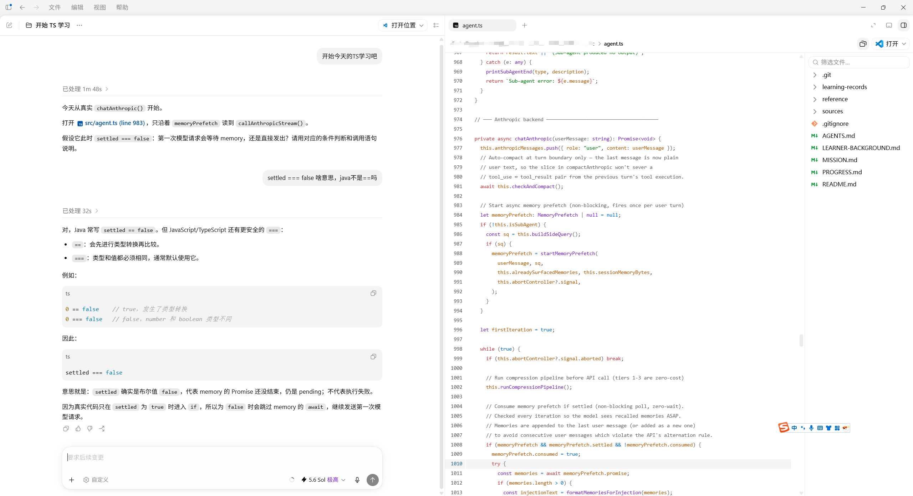
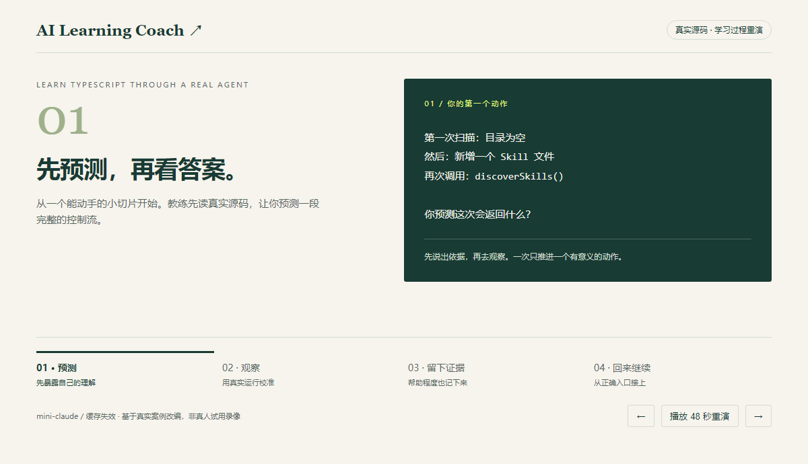

# AI Learning Coach

[](https://github.com/chrichuang218/ai-learning-coach/stargazers)
[](LICENSE)
[](https://github.com/chrichuang218/ai-learning-coach/actions/workflows/validate.yml)

[English](README.en.md) · [第一次体验](examples/first-session/README.md) · [安装说明](docs/install.md)

**用真实 Agent 项目学会 TypeScript。教练记住你卡在哪里，带你预测、调试、修改，并用实际证据判断下一步。**

首要面向已经会 Java 或其他后端语言、希望进入 TypeScript / Agent 开发的开发者。你不需要先设计课程、挑文件或整理学习档案；教练先读项目，再给一个当前能动手的切片。

<p align="center">
  
</p>

## 一分钟看懂

| 当你…… | 教练会…… |
| --- | --- |
| 想开始，但不知道读哪里 | 根据背景和真实源码选择一个可观察的小任务 |
| 当场答对，隔天却讲不清 | 找到丢失的关系，调整讲法和掌握判断 |
| 亲自跑通了教练给的测试 | 记录执行证据，保留“独立设计测试”这个待验证边界 |
| 过几天回来继续 | 读取最近证据、核对当前源码，从正确入口接上 |

[观看学习过程重演](docs/demo.md)：预测 → 观察 → 记录帮助程度 → 下一次继续。重演用于展示流程，不代表新用户试用结果。



## 安装，然后开始

```bash
codex plugin marketplace add chrichuang218/ai-learning-coach
codex plugin add ai-learning-coach@ai-learning-coach
```

使用 Claude Code：

```bash
claude plugin marketplace add chrichuang218/ai-learning-coach
claude plugin install ai-learning-coach@ai-learning-coach
```

Cursor、Gemini CLI 等其他 Agent 可以只装 Skill，见 [安装说明](docs/install.md#其他-agentcursorgemini-cliopencode-等)。

安装后**新开一个会话**，直接说：

```text
我会 Java，想通过真实 Agent 项目学习 TypeScript。帮我选择第一个源码入口，然后带我开始。
```

已有项目时把路径一起发给教练，就从你的项目开始。没有项目时，教练会从 [起步路线](plugins/ai-learning-coach/skills/learning-coach/STARTER-TRACKS.md) 中选一个真实仓库（TypeScript Agent、Python、Go、前端、Rust）；也可以先试 [缓存失效首次体验](examples/first-session/README.md)：固定真实源码版本、一个可运行测试、一个下一入口，学习预算约 15 分钟。

状态工具（记录证据、到期复习、周复盘、自动计算进度）通过 [uv](https://docs.astral.sh/uv/) 启动，装好 uv 即可，依赖会自动准备；没有 uv 时，普通 Skill 教学通过文件工具照常进行。完整的环境、skills.sh 分发区别和排障见 [安装说明](docs/install.md)。

公共命令安装远端发布版本。本版包含首次体验与可选状态工具；开发者可用隔离环境验证本地源码：

```bash
python scripts/release_smoke.py
```

## 进展有依据，回来能继续

学习档案称为 **Learning Lab**：你自己的 Markdown 文件，可按需创建，无需安装第二个产品。

- **使命**：你想独立完成什么。
- **证据**：你的预测、解释、Run、Debug 或修改，以及获得了多少帮助。
- **当前状态**：已能做到什么、还需验证什么、下一处真实入口。
- **稳定知识**：值得复习的结论，可被 Obsidian 等工具继续使用。

打卡记录节奏，能力来自证据。百分比只是约定里程碑的汇总，由工具计算，证据不足时工具会拒绝升级；需要复验的边界到期后，教练会在下次开始时先带你回忆。中文和英文档案都能读取。

[查看本地进度页与诊断工具](docs/learning-lab.md) · [单轨道初始示例](examples/workspaces/first-session/README.md) · [多轨道示例](examples/workspaces/minimal-multitrack/README.md)

## 一个插件，两个教练

| 你当前的请求 | 负责的 Skill |
| --- | --- |
| 开始、继续、这行没懂、怎么 Debug、学完了 | learning-coach：日常学习与证据记录 |
| 方向太多、先学什么、是否继续投入 | focus-coach：阶段目标与主线取舍 |

中文优先；可明确要求其他语言。写作、语言、考试、研究等扩展方法见 [跨领域示例](examples/cross-domain-sample-outputs.md)。当前最完整的实战材料集中在源码学习。

## 验证和参与

已有静态校验、隔离安装冒烟、两种宿主启动配置下的 MCP 全工具冒烟，以及可按需运行的自动行为评估（12 个场景，见 [评估与复现](evals/README.md)）。真人首次完成率与七日复用仍待自愿试用反馈，不用 Star 或文件数量代替。

```bash
python -m pip install pyyaml
python scripts/validate_repo.py
python -m unittest discover -s tests -v
```

[第一次使用成功了或卡住了？](https://github.com/chrichuang218/ai-learning-coach/issues/new?template=first_experience.yml) 只需告诉我们你的场景和做到哪一步。

[使用与设计指南](docs/guide.md) · [评估与复现](evals/README.md) · [贡献](CONTRIBUTING.md) · [更新记录](CHANGELOG.md)

## 致谢

受到 Matt Pocock 的 [teach Skill](https://github.com/mattpocock/skills/blob/main/skills/productivity/teach/SKILL.md) 启发，并根据真实长期学习反馈演进。感谢 [LINUX DO](https://linux.do/) 社区的支持与讨论。

[MIT License](LICENSE)
